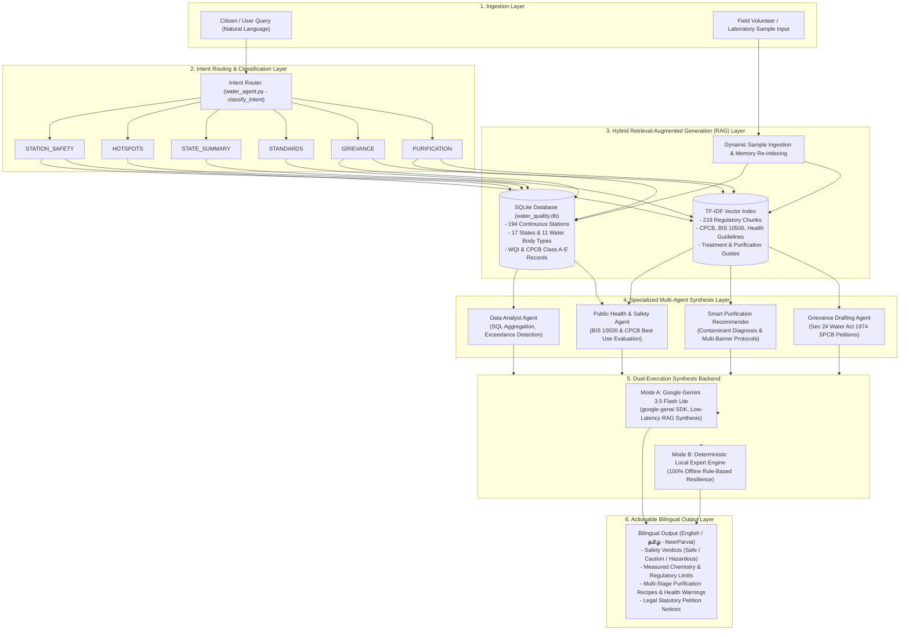

# NeerParvai (நீர் பார்வை) 💧
### AI Agent-Based Intelligent Water Quality Monitoring, Public Awareness & Purification Recommender Assistant Using RAG

**NeerParvai (நீர் பார்வை)** is an intelligent environmental monitoring, citizen advisory, and smart purification recommendation assistant built on top of official Indian water quality monitoring data from the **Central Pollution Control Board (CPCB)**. It combines **Retrieval-Augmented Generation (RAG)**, a **Multi-Agent Orchestrator**, deterministic environmental calculations (WQI, CPCB Classifications), and bilingual (English / தமிழ்) public health and purification protocols.

---

## 🌟 Key Features

1. **Dual-Retrieval RAG Engine**:
   - **Structured Query Engine (SQLite)**: Sub-second analytical queries across 194 continuous monitoring stations across 17 States and 11 water body types (Rivers, Canals, Drains, Lakes, Ponds, Beaches, Marine outfalls, STPs).
   - **Semantic Vector Engine (TF-IDF + Cosine Ranking)**: Semantic search over official regulatory guidelines, including CPCB Designated Best Use standards, Bureau of Indian Standards (BIS 10500:2012) potable water limits, waterborne pathogen risks, and remediation policies.

2. **Environmental & Public Health Intelligence**:
   - **CPCB Designated Best Use Classification**: Automatically categorizes water into Class A, B, C, D, E, or Non-Compliant / Below Class E.
   - **Water Quality Index (WQI)**: Weighted arithmetic scoring (0 to 100) assessing DO, BOD, pH, Electrical Conductivity, Nitrates, and Coliform organisms.
   - **Citizen Safety Verdicts**: Translates complex chemical readings into clear advice:
     - 🟢 *Safe for organized outdoor bathing*
     - 🟡 *Caution: moderate microbial load*
     - 🔴 *Hazardous: severe raw sewage / industrial contamination*

3. **Multi-Agent Workflow**:
   - **Intent Router**: Automatically classifies user queries into *Station Safety*, *Pollution Hotspots*, *State Overview*, *Standards Education*, or *Grievance Petitioning*.
   - **Data Analyst Agent**: Executes SQL queries, aggregates state metrics, and detects extreme exceedances.
   - **Public Health & Awareness Agent**: Generates plain-language advisories tailored to citizens, pilgrims, farmers, and local communities.
   - **Grievance Drafting Agent**: Automatically generates formal legal petition letters citing the *Water (Prevention and Control of Pollution) Act, 1974* for filing with State Pollution Control Boards (SPCBs).

4. **Dual Execution Mode**:
   - **Local Expert Engine**: Works 100% offline out-of-the-box with zero API keys or external dependencies.
   - **LLM Agent Mode**: Seamlessly switches to Google Gemini (`gemini-3.5-flash-lite` via `google-genai`) using credentials from `.env` for low-latency, high-accuracy RAG synthesis.

5. **Citizen Science & Manual Data Ingestion**:
   - Allows users, field volunteers, and local laboratories to manually input custom water quality readings (DO, BOD, pH, Coliforms, Conductivity, etc.).
   - Instantly computes WQI and CPCB Best Use classifications on the fly.
   - Automatically saves and dynamically indexes the new sample into SQLite and the RAG semantic memory so the AI assistant can immediately answer inquiries about the newly added location.

6. **Smart Water Purification & Treatment Recommender (English & தமிழ்)**:
   - Diagnoses chemical and microbiological contaminants (Turbidity, Total/Fecal Coliform, High BOD, Excess Nitrates, High Salinity/Conductivity, Acidity/Alkalinity).
   - Generates multi-stage household protocols (Sedimentation/Coagulation, Disinfection via Boiling/UV/Chlorination, Activated Carbon Adsorption, RO Demineralization).
   - Provides community-scale multi-barrier treatment recommendations (Rapid Sand Filtration, Pressure Sand Filter, Industrial Dual-Bed Ion Exchange, Activated Sludge/MBBR).
   - Features **Critical Health Warnings**, including strict contraindication against boiling high-nitrate water for infants (preventing Methemoglobinemia / "Blue Baby Syndrome").
   - Full bilingual support in English and Tamil (தமிழ்).

---

## 🏗️ Workflow & System Architecture

NeerParvai follows a modular, hybrid architecture combining deterministic environmental calculations, multi-agent intent routing, relational analytical querying, vector semantic search, and dual-backend response synthesis.

### 1. Architectural Diagram



```text
+---------------------------------------------------------------------------------+
|                       Citizen / User Natural Language Query                     |
+---------------------------------------------------------------------------------+
                                         |
                                         v
+---------------------------------------------------------------------------------+
|                   Intent Router (water_agent.py - classify_intent)              |
+---------------------------------------------------------------------------------+
       |               |               |              |             |            |
       v               v               v              v             v            v
 [STATION_SAFETY]  [HOTSPOTS]  [STATE_SUMMARY]  [STANDARDS]   [GRIEVANCE]  [PURIFICATION]
       |               |               |              |             |            |
+--------------------------------------+--------------+--------------------------+
|                     Hybrid Retrieval-Augmented Generation Engine                |
|  * SQLite Analytical Query Engine (Indexed 194 Stations across 17 States)      |
|  * TF-IDF & Cosine Vector Semantic Search (219 Domain Knowledge Chunks)        |
+---------------------------------------------------------------------------------+
                                         |
                                         v
+---------------------------------------------------------------------------------+
|                   Synthesis Backend (Dual-Execution Strategy)                   |
|  * Mode A: Google Gemini 3.5 Flash Lite via google-genai SDK (Low Latency)     |
|  * Mode B: Deterministic Local Expert Rule Engine (100% Offline Resilience)     |
+---------------------------------------------------------------------------------+
                                         |
                                         v
+---------------------------------------------------------------------------------+
|             Actionable Bilingual Output (English / தமிழ் - NeerParvai)          |
+---------------------------------------------------------------------------------+
```

---

### 2. Multi-Agent Roles & Specializations

As detailed in [`AGENTS.md`](AGENTS.md), the system employs specialized agent modules coordinating across distinct analytical domains:

| Agent Module | Primary Responsibility | Backing Knowledge / Tools |
| :--- | :--- | :--- |
| **Intent Router** | Parses natural language input, detects semantic keywords/intent, and dispatches to appropriate retrieval pipelines. | `water_agent.py` (`classify_intent`) |
| **Data Analyst Agent** | Executes structured SQL queries against `water_quality.db`, computes aggregations, identifies pollution outliers, and ranks stations. | SQLite engine, `clean_water_data.csv`, `data_processor.py` |
| **Public Health & Safety Agent** | Assesses chemical parameters ($DO, BOD, pH, EC, Nitrate, Coliform$), maps to CPCB Classes A–E and BIS 10500 standards, and provides safety verdicts. | `cpcb_water_standards.md`, `bis_10500_standards.md`, `health_risk_guidelines.md` |
| **Smart Purification Recommender Agent** | Analyzes measured contaminants to prescribe multi-barrier household and community treatment protocols with critical health warnings. | `purification_recommender.py`, `water_purification_guide.md` |
| **Grievance Drafting Agent** | Formulates formal legal notices and petitions citing Section 24 of the *Water Act, 1974* with station readings for SPCB submission. | `remediation_policy.md`, statutory templates |

---

### 3. End-to-End Workflow Stages

#### Stage 1: Input Ingestion & Citizen Science
- **Natural Language Queries**: Captured via the Streamlit chat interface (e.g., *"Is River Betwa at Charantirghat safe for bathing?"*, *"Show top 5 polluted stations in Delhi"*).
- **Manual Sample Submission**: Field researchers and citizens input custom parameter readings (DO, BOD, pH, Coliforms, Conductivity, Nitrates) via the UI form. The system dynamically computes the Water Quality Index (WQI), assigns CPCB Best Use Class, inserts the sample into SQLite, and re-indexes the TF-IDF vector memory in real-time.

#### Stage 2: Intent Classification & Routing
The Intent Router evaluates incoming queries and maps them to one of six dedicated execution paths:
1. `STATION_SAFETY`: Location-specific water quality assessment and bathing/drinking safety.
2. `HOTSPOTS`: Identification and ranking of critically polluted water bodies by BOD/Coliform levels.
3. `STATE_SUMMARY`: Aggregated statistics, state-wide water quality distributions, and class breakdowns.
4. `STANDARDS`: Educational inquiries about regulatory benchmarks (CPCB Classes A–E, BIS 10500 limits, parameter definitions).
5. `GRIEVANCE`: Automated generation of formal SPCB petition letters citing legal non-compliance under the *Water Act, 1974*.
6. `PURIFICATION`: Chemical/microbial contaminant diagnosis and tailored household/community purification instructions.

#### Stage 3: Hybrid Retrieval-Augmented Generation (RAG)
Retrieval operates via two complementary engines:
- **Relational SQL Retrieval**: Queries indexed SQLite tables across 194 continuous stations in 17 States and 11 water body categories.
- **Semantic Vector Search**: Scans 219 tokenized knowledge chunks across regulatory standards, toxicological profiles, remediation policies, and purification protocols using TF-IDF vectorization with cosine similarity scoring.

#### Stage 4: Dual-Engine Synthesis
- **Mode A (LLM Synthesis - Gemini 3.5 Flash Lite)**: When `GEMINI_API_KEY` is present in `.env`, the prompt and retrieved context are synthesized using `gemini-3.5-flash-lite` via the `google-genai` SDK with strict timeout protection. System prompts enforce direct, concise, question-specific answers without boilerplate.
- **Mode B (Deterministic Local Expert)**: If offline or without an API key, the system falls back seamlessly to a 100% deterministic rule-based engine that constructs accurate, structured reports from retrieved records.

#### Stage 5: Bilingual Delivery & Actionable Safety Verdicts
Results are formatted into concise Markdown with bilingual support (English / தமிழ்):
- **Safety Badge**: 🟢 Safe, 🟡 Caution, or 🔴 Hazardous.
- **Measured Parameters vs. Standards**: Parameter-by-parameter breakdown with unit measurements.
- **Purification Recipe**: Step-by-step physical and chemical treatment sequence.
- **Critical Health Warnings**: Prominent warnings (e.g., strict prohibition against boiling high-nitrate water for infants).

---

## 📁 Repository Structure

```
water-quality-management-system/
├── Indian_water_data.csv        # Raw dataset (194 stations, 17 states, 2021-2023)
├── clean_water_data.csv         # Cleaned & enriched dataset with WQI & CPCB tags
├── water_quality.db             # Indexed SQLite database for fast analytical queries
├── data_processor.py            # Preprocessing pipeline, BDL handler, WQI calculator
├── rag_engine.py                # Hybrid RAG retrieval engine (Semantic + Relational)
├── water_agent.py               # Multi-agent orchestrator & advisory synthesis
├── purification_recommender.py  # Smart Water Purification & Treatment Recommender (En & Ta)
├── app.py                       # Streamlit web dashboard & chat assistant
├── test_prototype.py            # End-to-end automated verification test suite
└── knowledge_base/              # Regulatory & health markdown documents
    ├── cpcb_water_standards.md  # CPCB Designated Best Use Classes A-E
    ├── bis_10500_standards.md   # BIS 10500 potable water benchmarks
    ├── health_risk_guidelines.md# Health risks of coliform, nitrates, and low DO
    ├── remediation_policy.md    # Statutory acts & remediation guidelines
    └── water_purification_guide.md # Multi-barrier purification protocols & warnings
```

---

## 🚀 Getting Started

### 1. Run Automated Test Suite
Verify that all data pipelines, RAG indexing, database queries, and agents are functioning correctly:
```powershell
python test_prototype.py
```

### 2. Launch the Interactive Web Dashboard
Run the Streamlit web application:
```powershell
streamlit run app.py
```
This opens the web interface in your default browser at `http://localhost:8501`.

---

## 💡 Example Queries You Can Ask the Assistant

- **Station Safety**:
  - *"Is River Betwa at Charantirghat safe for holy dipping?"*
  - *"Check water quality at Rushikonda Beach, Visakhapatnam."*
- **Pollution Hotspots**:
  - *"Show the top 5 most polluted water bodies with the highest BOD."*
  - *"Which drains in Delhi or Punjab have critical bacterial levels?"*
- **State Overviews**:
  - *"Give a state summary and CPCB class distribution for Jharkhand."*
- **Citizen Action & Legal Grievance**:
  - *"Draft a formal SPCB grievance petition for Agra Canal under the Water Act 1974."*
- **Public Health & Education**:
  - *"Explain what Biochemical Oxygen Demand (BOD) means and why high coliform count is dangerous."*

